<div align="center">

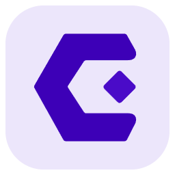

# Edros Music Player

**Reproductor de música y video para Windows.** Escucha tus MP3 y videos o lo que quieras de YouTube **sin anuncios**, con preamplificador y ecualizador, letras tipo karaoke, doble pantalla, control desde el celular y una mascota que baila contigo.

[](https://github.com/Reingardo/Edros-Music-Player/releases/latest)
&nbsp;
[](https://github.com/Reingardo/Edros-Music-Player/releases)
&nbsp;

&nbsp;


[**⬇️ Descargar**](https://github.com/Reingardo/Edros-Music-Player/releases/latest) ·
[**📘 Tutorial de instalación**](docs/INSTALACION.md) ·
[**🎧 Guía de uso**](docs/GUIA-DE-USO.md) ·
[**🛠️ Documentación técnica**](docs/DESARROLLO.md)

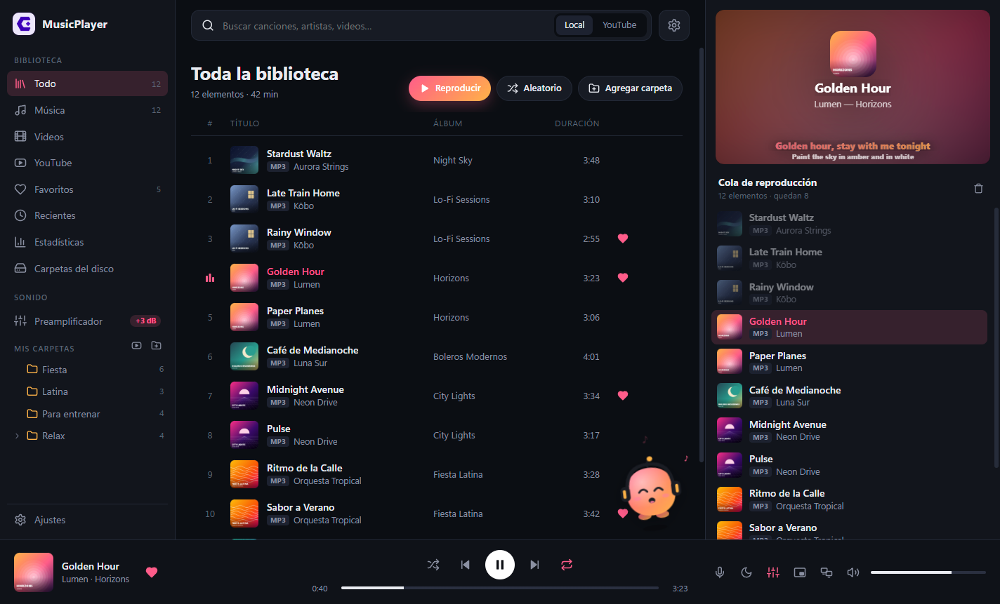

</div>

> Las canciones, artistas y carátulas de las capturas son de demostración (inventados y generados para este proyecto).

---

## ✨ Funciones

| | |
|---|---|
| 🎵 **Tu música y tus videos** | MP3, FLAC, WAV, M4A, OGG, OPUS, MP4, MKV, WEBM, MOV… Lee título, artista, álbum y carátula. |
| ▶️ **YouTube sin anuncios** | Busca y reproduce dentro de la app. Importa listas completas como carpetas. |
| 🎚️ **Preamplificador y ecualizador** | Hasta +18 dB, 10 bandas, limitador, igualador de volumen y ajustes guardados. |
| 🎤 **Letras sincronizadas** | Vista de letra y modo karaoke en la pantalla de video. |
| 🖥️🖥️ **Doble pantalla** | El video va al segundo monitor y esta ventana queda como control. |
| 📱 **Control desde el celular** | Escanea un QR y usa el teléfono como control remoto, sin instalar nada. |
| 📁 **Carpetas organizadas** | Carpetas y subcarpetas que mezclan canciones locales y videos de YouTube. |
| ❤️ **Favoritos y estadísticas** | Recientes, más escuchadas, artistas favoritos y tiempo escuchado. |
| 🌙 **Temporizador para dormir** | La música baja poco a poco y se apaga sola. |
| 🔀 **Transiciones y radio** | Fundido entre canciones y modo radio que sigue con canciones parecidas. |
| 🪟 **Integración con Windows** | Mini reproductor flotante, icono junto al reloj, botones en la barra de tareas y avisos. |
| 🎨 **Personalización** | Español / inglés, 6 temas de color y la mascota **Tempo** con accesorios. |

---

### 🎵 Biblioteca, búsqueda y favoritos

Agrega las carpetas donde guardas tu música o arrastra archivos a la ventana. La búsqueda filtra al instante por título, artista o álbum. Marca tus canciones con ❤ (o la tecla **F**) para encontrarlas en **Favoritos**, y en **Recientes** verás lo último que escuchaste.

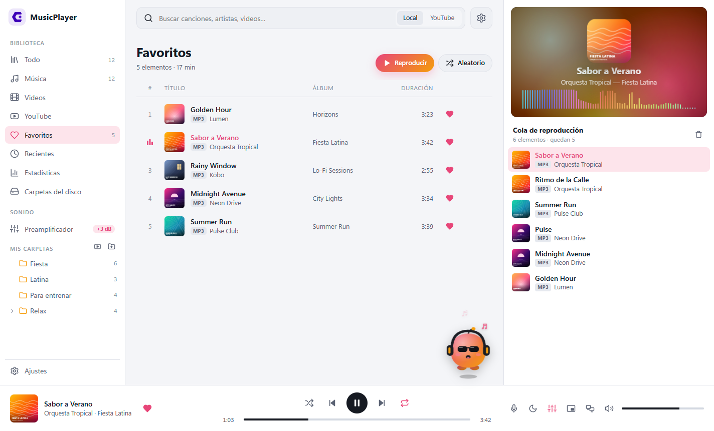

### ▶️ YouTube sin anuncios

Cambia el buscador a **YouTube**, escribe y pulsa Enter. Los videos se reproducen dentro de la app y **sin anuncios**: se bloquean los servidores de publicidad, se quitan los anuncios de la respuesta del reproductor y, si alguno se cuela, se silencia y se salta automáticamente.

- Pega un **enlace de video** en el buscador y se reproduce directamente.
- Pega un **enlace de una lista** y se importa entera como carpeta (también desde el icono de YouTube junto a *Mis carpetas*).
- Activa el **modo radio**: cuando se acaba la cola, la app sigue con canciones parecidas.

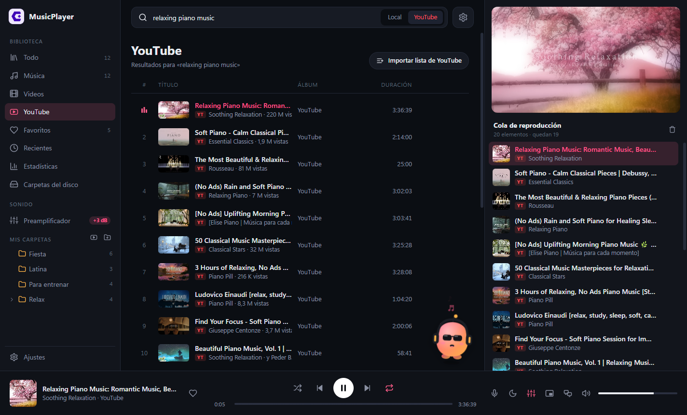

### 🎚️ Preamplificador y ecualizador

- **Preamplificador** de −12 a +18 dB para canciones o videos que suenan bajos.
- **Ecualizador de 10 bandas** (32 Hz – 16 kHz) con curva de respuesta en tiempo real.
- 12 **ajustes predefinidos** (Bajos potentes, Rock, Reggaetón, Salsa, Voces…) y **tus propios ajustes** guardados.
- **Limitador anti-saturación** para que el sonido no se distorsione.
- **Igualar volumen**: que unas canciones no suenen mucho más fuerte que otras.
- Funciona con tus archivos **y con YouTube**.

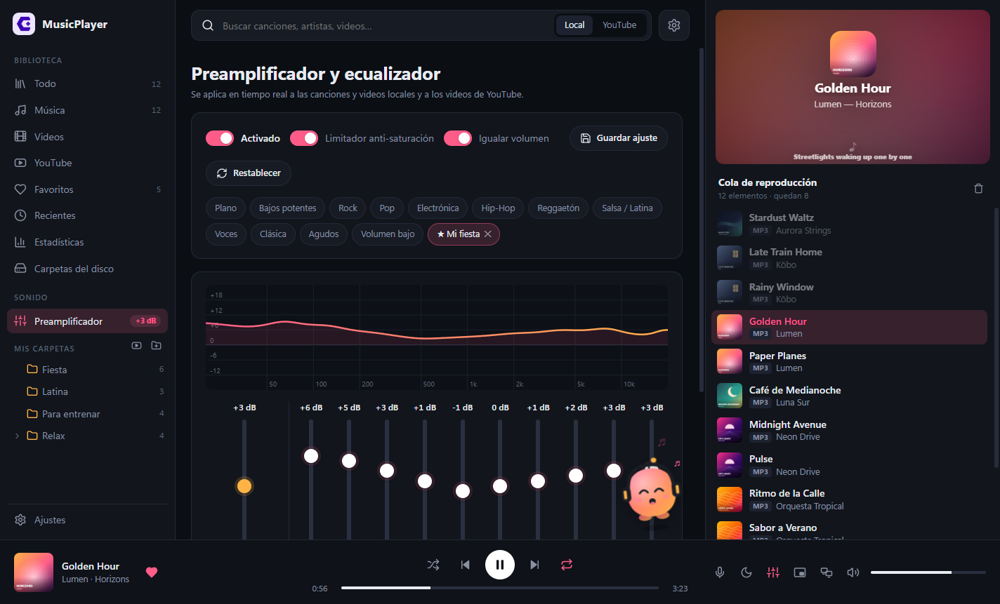

### 📁 Carpetas organizadas, con su propio ecualizador

Crea carpetas y subcarpetas (Fiesta, Para entrenar, Relax…) y arrastra canciones encima. Cada carpeta puede tener **su propio ajuste de ecualizador**, que se aplica solo al reproducirla.

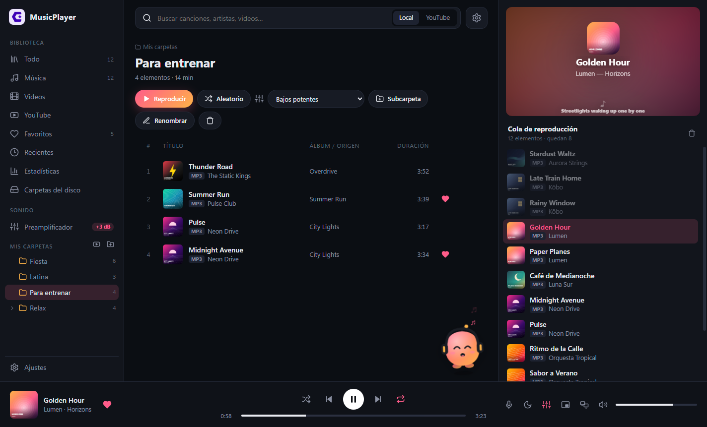

### 🎤 Letras sincronizadas (karaoke)

Pulsa el micrófono (o la tecla **L**) para ver la letra, que avanza con la canción; haz clic en una línea para saltar a ese momento. Si tienes un archivo `.lrc` con el mismo nombre que la canción, se usa ese; si no, la letra se busca en [lrclib.net](https://lrclib.net).

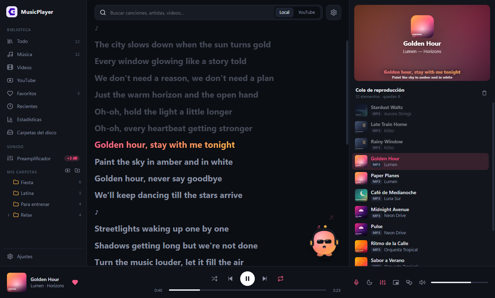

### 🖥️🖥️ Doble pantalla y visualizadores

El botón de los dos monitores manda el video (o la carátula con el visualizador) a tu **segundo monitor en pantalla completa**, con la letra en modo karaoke. La ventana principal queda para controlar la música. Hay cuatro visualizadores: **barras, onda, círculo y fiesta**.

<table>
<tr>
<td>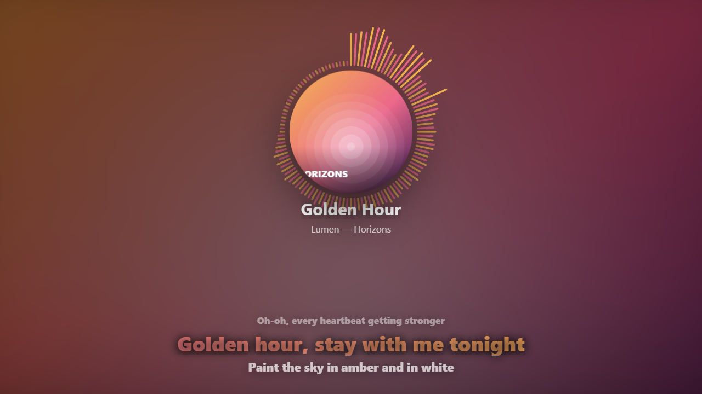</td>
<td>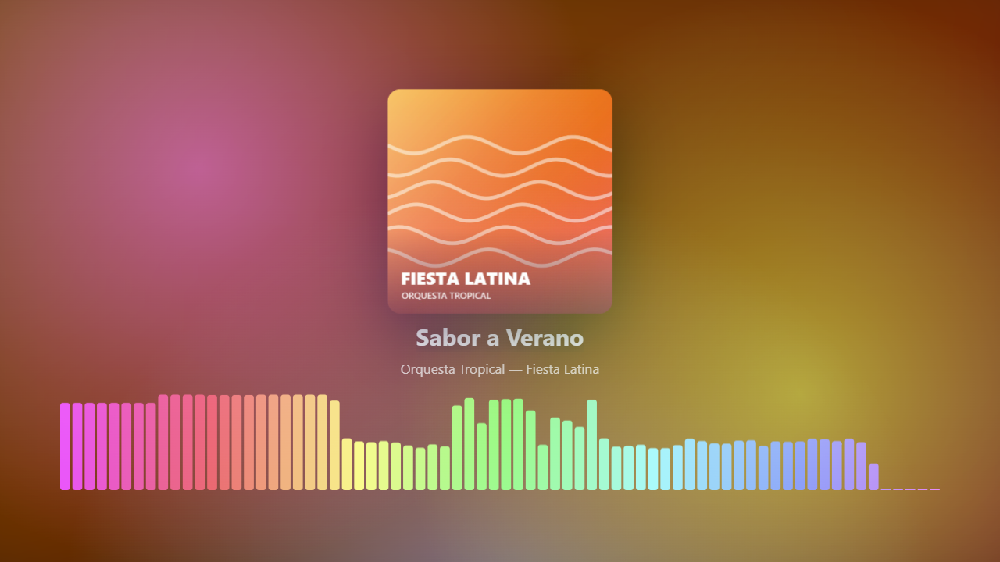</td>
</tr>
</table>

### 📱 Control desde el celular

En **Ajustes → Control desde el celular**, actívalo y escanea el QR con el teléfono (en el mismo Wi-Fi). Puedes pausar, saltar canciones, adelantar, cambiar el volumen, ver la cola y saltar a cualquier canción, buscar en tu música o en YouTube y marcar favoritos. El enlace lleva una clave secreta: sin el QR, nadie más puede usarlo.

<div align="center">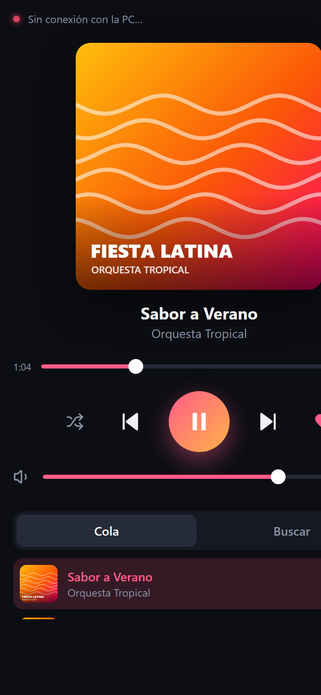</div>

### ❤️ Estadísticas

Descubre lo que más escuchas: reproducciones, tiempo escuchado, canciones más escuchadas y artistas favoritos.

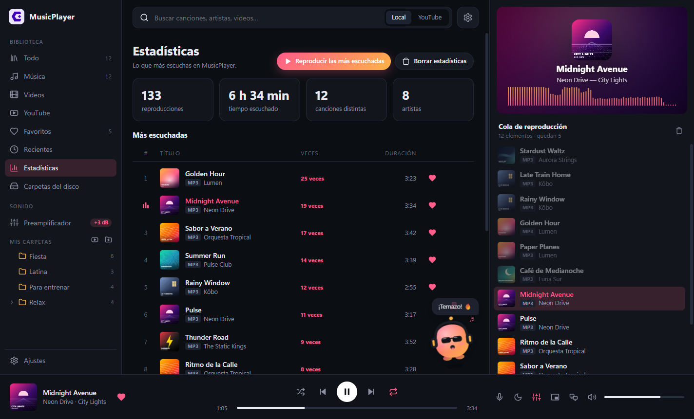

### 🪟 Integración con Windows

- **Mini reproductor flotante**, siempre encima de las demás ventanas.
- **Icono junto al reloj** con menú de reproducción.
- **Botones de anterior / reproducir / siguiente** en la miniatura de la barra de tareas.
- **Aviso de "Ahora suena"** al cambiar de canción.
- **Teclas multimedia** del teclado, aunque la ventana no esté enfocada.
- **Temporizador para dormir** (15–90 minutos o al terminar la canción).

<div align="center">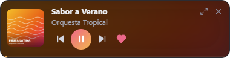</div>

### 🎨 Ajustes y la mascota Tempo

El engrane ⚙ (o `Ctrl + ,`) abre los ajustes: **idioma** (español o inglés), **6 temas de color** (Atardecer, Océano, Bosque, Neón, Brasa y Claro), reproducción, pantalla de video, control remoto y la mascota.

**Tempo** es la mascota de Edros Music Player. Baila al ritmo de los graves, se duerme cuando pausas, comenta cuando cambias de canción y baila distinto según el género: hace *headbang* con el rock, pasos de salsa con la música latina y se mece con las baladas. Ponle gafas, gorra, corona, moño o gorro de fiesta, arrástrala a donde quieras o apágala.

<table>
<tr>
<td>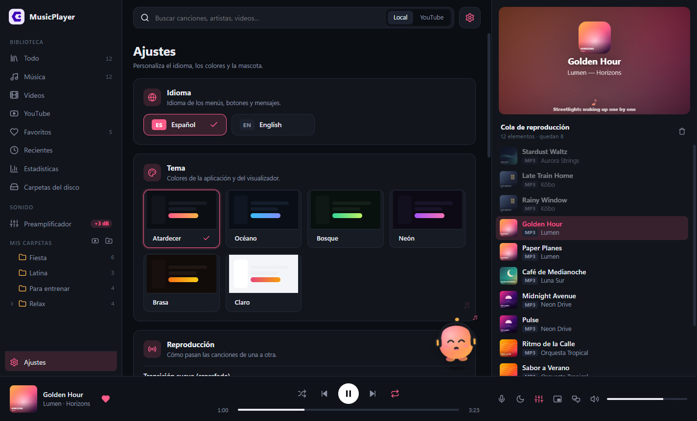</td>
<td>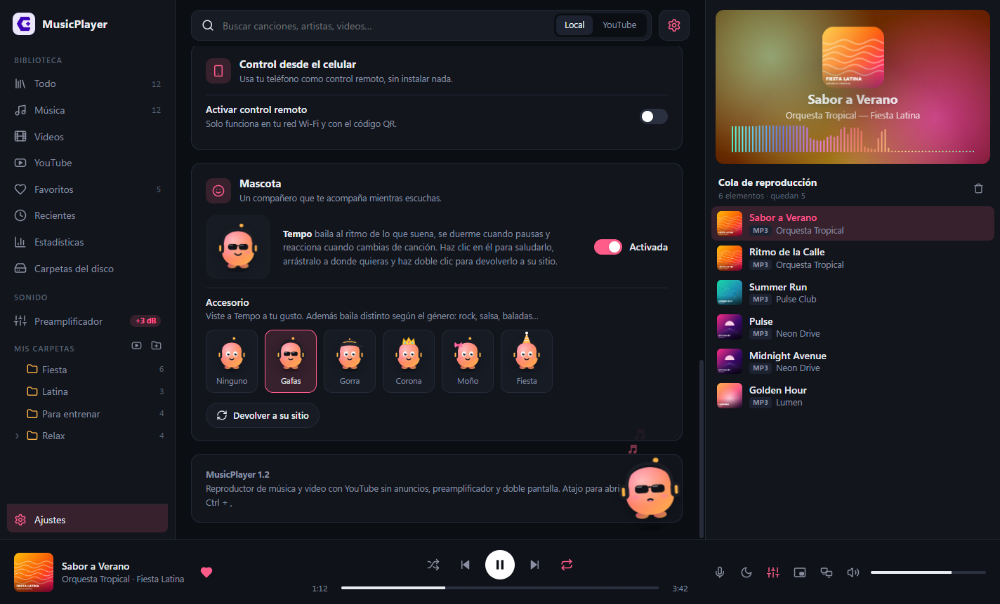</td>
</tr>
</table>

---

## ⬇️ Instalación rápida

1. Ve a [**Releases**](https://github.com/Reingardo/Edros-Music-Player/releases/latest) y descarga **`MusicPlayer-Setup-x.y.z.exe`**.
2. Ábrelo. Si Windows muestra *"Windows protegió tu PC"*, pulsa **Más información → Ejecutar de todas formas** (el instalador no está firmado digitalmente).
3. Sigue el asistente: elige la carpeta y pulsa **Instalar**. Se crean accesos directos en el escritorio y en el menú Inicio.
4. Abre **MusicPlayer**, ve a **Carpetas del disco → Agregar carpeta** y elige la carpeta de tu música.

👉 Tutorial completo, con solución de problemas: [**docs/INSTALACION.md**](docs/INSTALACION.md)

**Requisitos:** Windows 10 u 11 de 64 bits. Para YouTube, las letras y el modo radio hace falta conexión a internet.

---

## ⌨️ Atajos de teclado

| Tecla | Acción | Tecla | Acción |
|---|---|---|---|
| `Espacio` | Reproducir / pausa | `M` | Silenciar |
| `Ctrl` + `→` / `←` | Siguiente / anterior | `S` / `R` | Aleatorio / repetir |
| `→` / `←` | Adelantar / retroceder 5 s | `F` | Favorito |
| `↑` / `↓` | Volumen | `L` | Letra |
| `Ctrl` + `F` | Buscar | `Ctrl` + `,` | Ajustes |
| `Supr` | Quitar de la carpeta abierta | `Ctrl` + `A` | Seleccionar todo |

---

## 🔒 Privacidad

- Tu música, carpetas, favoritos y estadísticas se quedan **en tu PC** (`%APPDATA%\MusicPlayer`).
- La app solo se conecta a internet para **YouTube** (búsquedas y videos) y para buscar **letras** en lrclib.net, enviando el título y el artista de la canción. Si existe un `.lrc` local, no se consulta nada.
- El **control desde el celular** está apagado por defecto. Al activarlo solo funciona en tu red local y con la clave del código QR.

---

## 🛠️ Para desarrolladores

```bash
git clone https://github.com/Reingardo/Edros-Music-Player.git
cd Edros-Music-Player
npm install
npm start          # abrir la app en modo desarrollo
npm run dist       # crear el instalador en dist/
```

La arquitectura, la estructura de carpetas y el funcionamiento interno están en [**docs/DESARROLLO.md**](docs/DESARROLLO.md). Los cambios de cada versión están en el [**CHANGELOG**](CHANGELOG.md).

---

## ❓ Preguntas frecuentes

<details>
<summary><b>Un video de YouTube dice que "el propietario no permite reproducirlo fuera de YouTube"</b></summary>

Algunos dueños de videos desactivan la reproducción en otras aplicaciones. La app te avisa y salta al siguiente de la cola.
</details>

<details>
<summary><b>¿Se pueden descargar canciones de YouTube?</b></summary>

No. La app reproduce YouTube en streaming; no descarga ni convierte videos.
</details>

<details>
<summary><b>El celular no se conecta al control remoto</b></summary>

Comprueba que el teléfono y la PC estén en la **misma red Wi-Fi** y que Windows permita la app en el firewall para **redes privadas**. Más detalles en el [tutorial de instalación](docs/INSTALACION.md#-control-desde-el-celular).
</details>

<details>
<summary><b>¿Dónde se guardan mis datos? ¿Se pierden al actualizar?</b></summary>

En `%APPDATA%\MusicPlayer\musicplayer-data.json`. Al instalar una versión nueva se conservan.
</details>

---

<div align="center">

Hecho con ❤️ por **Edros** · Licencia [MIT](LICENSE)

</div>
