# 🎧 Guía de uso

Todo lo que puedes hacer con **Edros Music Player**, explicado sección por sección.

**Índice**

- [La ventana principal](#la-ventana-principal)
- [Reproducir y la cola](#reproducir-y-la-cola)
- [Buscar: tu música y YouTube](#buscar-tu-música-y-youtube)
- [Favoritos, recientes y estadísticas](#favoritos-recientes-y-estadísticas)
- [Mis carpetas](#mis-carpetas)
- [Importar listas de YouTube](#importar-listas-de-youtube)
- [Editar la información de una canción](#editar-la-información-de-una-canción)
- [Preamplificador y ecualizador](#preamplificador-y-ecualizador)
- [Letras sincronizadas](#letras-sincronizadas)
- [Doble pantalla y visualizadores](#doble-pantalla-y-visualizadores)
- [Temporizador para dormir](#temporizador-para-dormir)
- [Mini reproductor e integración con Windows](#mini-reproductor-e-integración-con-windows)
- [Control desde el celular](#control-desde-el-celular)
- [Ajustes](#ajustes)
- [La mascota Tempo](#la-mascota-tempo)
- [Atajos de teclado](#atajos-de-teclado)

---

## La ventana principal

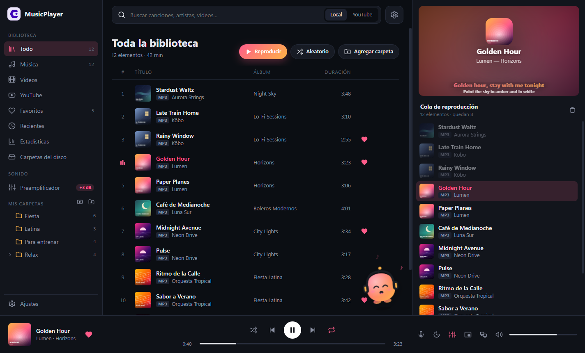

| Zona | Qué contiene |
|---|---|
| **Barra lateral** (izquierda) | Biblioteca (Todo, Música, Videos, YouTube, Favoritos, Recientes, Estadísticas, Carpetas del disco), Preamplificador, *Mis carpetas* y Ajustes. |
| **Centro** | Buscador (con el selector *Local / YouTube*), el engrane ⚙ y la lista o sección abierta. |
| **Derecha** | La **pantalla de video** (video, o carátula con visualizador y letra) y la **cola de reproducción**. |
| **Barra inferior** | Canción actual con ❤, controles (aleatorio, anterior, reproducir, siguiente, repetir), barra de progreso, y a la derecha: letra 🎤, temporizador 🌙, ecualizador, mini reproductor, doble pantalla y volumen. |

---

## Reproducir y la cola

- **Doble clic** en una canción, o el botón ▶ que aparece al pasar el ratón: reproduce esa lista desde esa canción.
- **Añadir a la cola** (icono ☰+ de la fila): la agrega al final sin interrumpir lo que suena.
- **Clic derecho** en una canción: *Reproducir a continuación*, *Añadir a la cola*, favoritos, carpetas, letra, editar información y *Mostrar en el Explorador*.
- **Selección múltiple**: `Ctrl` + clic o `Mayús` + clic; `Ctrl` + `A` selecciona todo.
- En la **cola** (derecha): doble clic para saltar a una canción, arrastra para reordenar y ✕ para quitar.
- **Aleatorio** (`S`) y **Repetir** (`R`: no → toda la cola → una canción).

---

## Buscar: tu música y YouTube

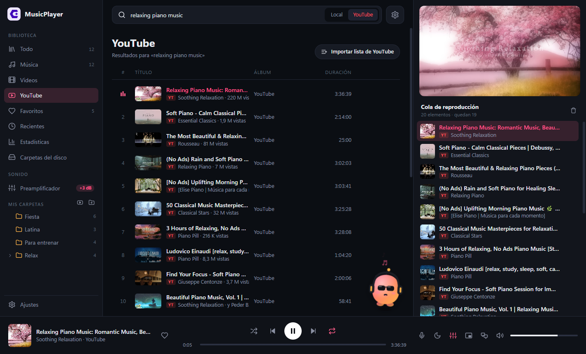

- Con el selector en **Local**, el buscador filtra al instante por título, artista, álbum o nombre de archivo. Si no hay resultados, pulsa Enter (o *Buscar en YouTube*) para buscar en YouTube.
- Con el selector en **YouTube**, escribe y pulsa **Enter**. *Cargar más resultados* trae la siguiente página.
- **Pega un enlace de YouTube** en el buscador y pulsa Enter: el video se reproduce. Si el enlace es de una lista, la app ofrece importarla.
- Los videos de YouTube se reproducen **sin anuncios**.

---

## Favoritos, recientes y estadísticas

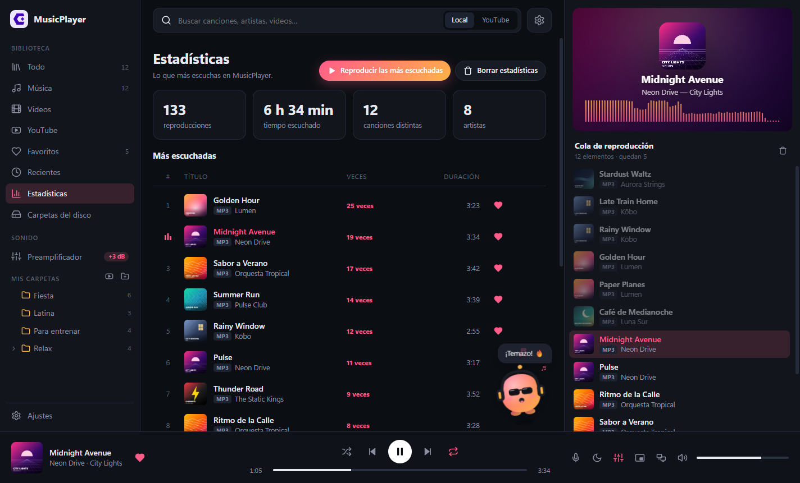

- **Favoritos ❤**: pulsa el corazón en la fila, en la barra inferior o la tecla `F`. Los encontrarás en **Favoritos**.
- **Recientes**: las últimas 100 canciones o videos que escuchaste. *Borrar historial* lo vacía.
- **Estadísticas**: reproducciones totales, tiempo escuchado, canciones distintas, artistas, **más escuchadas** y **artistas favoritos**. Una canción cuenta como escuchada a los 30 segundos (o a la mitad si es corta).

---

## Mis carpetas

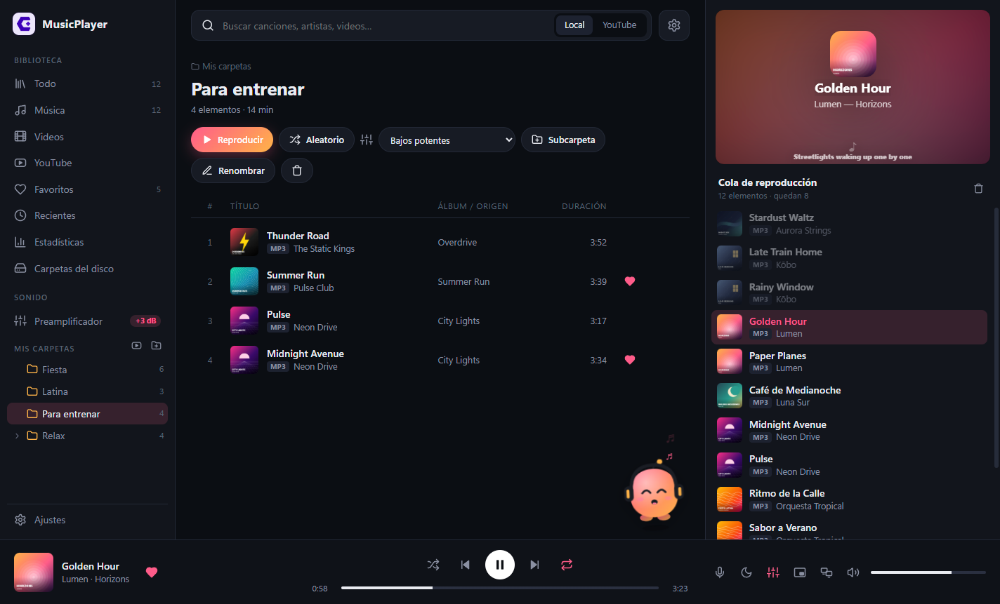

- **Crear**: icono 📁+ junto a *Mis carpetas*.
- **Subcarpetas**: pasa el ratón por una carpeta → 📁+, o el botón *Subcarpeta* dentro de ella.
- **Añadir canciones**: arrástralas sobre la carpeta (en la barra lateral o en las tarjetas de subcarpetas), o clic derecho → *Añadir a carpeta*.
- **Mover una carpeta**: arrástrala sobre otra, o sobre *Mis carpetas* para sacarla al nivel principal.
- **Ecualizador de la carpeta**: dentro de una carpeta, elige un ajuste en el selector 🎚️. Al reproducir esa carpeta, ese ecualizador se aplica solo.
- **Quitar canciones**: selecciónalas y pulsa `Supr` (o clic derecho → *Quitar de esta carpeta*). Tus archivos del disco **nunca** se borran.

Las carpetas pueden mezclar canciones locales y videos de YouTube.

---

## Importar listas de YouTube

1. Copia el enlace de una lista de reproducción de YouTube (contiene `list=`).
2. Pulsa el icono de **YouTube** junto a *Mis carpetas* (o *Importar lista de YouTube* en la sección YouTube) y pégalo. También puedes pegarlo directamente en el buscador.
3. Se crea una carpeta con el nombre de la lista y todos sus videos (hasta 500).

---

## Editar la información de una canción

Clic derecho en una canción local → **Editar información…**

- Cambia **título, artista, álbum y género**.
- En **MP3** también puedes cambiar la **carátula** (clic en la imagen). Los cambios se guardan **dentro del archivo**, así que los verán otros reproductores.
- En otros formatos, los cambios se guardan solo en la app.
- El **género** influye en cómo baila la mascota.

---

## Preamplificador y ecualizador

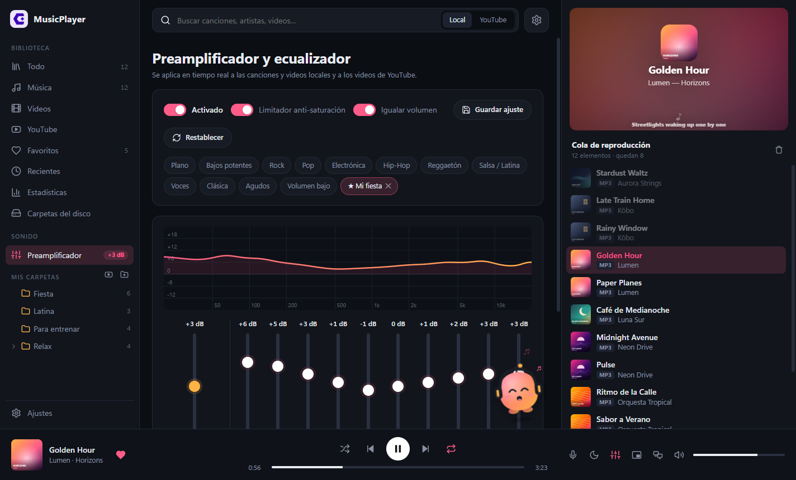

| Control | Para qué sirve |
|---|---|
| **Activado** | Enciende o apaga todo el procesamiento. |
| **Preamp** | Sube o baja la señal de −12 a +18 dB, útil para videos que suenan bajos. |
| **10 bandas** | 32 Hz (graves) a 16 kHz (agudos), ±12 dB. Doble clic en un deslizador lo pone a 0. |
| **Ajustes predefinidos** | Plano, Bajos potentes, Rock, Pop, Electrónica, Hip-Hop, Reggaetón, Salsa / Latina, Voces, Clásica, Agudos, Volumen bajo. |
| **Guardar ajuste** | Guarda la configuración actual con un nombre (aparece con ★; la ✕ lo borra). |
| **Limitador anti-saturación** | Evita la distorsión aunque subas mucho el preamplificador o los graves. |
| **Igualar volumen** | Comprime suavemente para que unas canciones no suenen mucho más fuerte que otras. |

La curva de arriba muestra la respuesta final del ecualizador. Todo se aplica en tiempo real a tus archivos **y a YouTube**.

---

## Letras sincronizadas

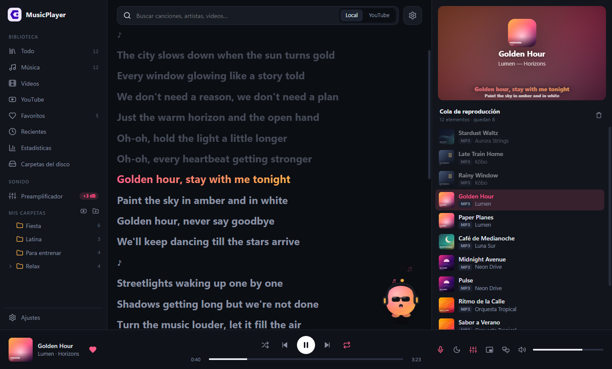

- Pulsa **🎤** en la barra inferior o la tecla `L`.
- La línea actual se resalta y la vista la sigue. **Haz clic en una línea** para saltar a ese momento.
- En la pantalla de video, la letra aparece en **modo karaoke** (se activa o desactiva en *Ajustes → Pantalla de video*).
- **Origen de la letra**: primero un archivo `.lrc` con el mismo nombre que la canción en la misma carpeta (por ejemplo `Mi canción.mp3` + `Mi canción.lrc`); si no existe, se busca en [lrclib.net](https://lrclib.net) por título y artista.

---

## Doble pantalla y visualizadores

<table><tr>
<td>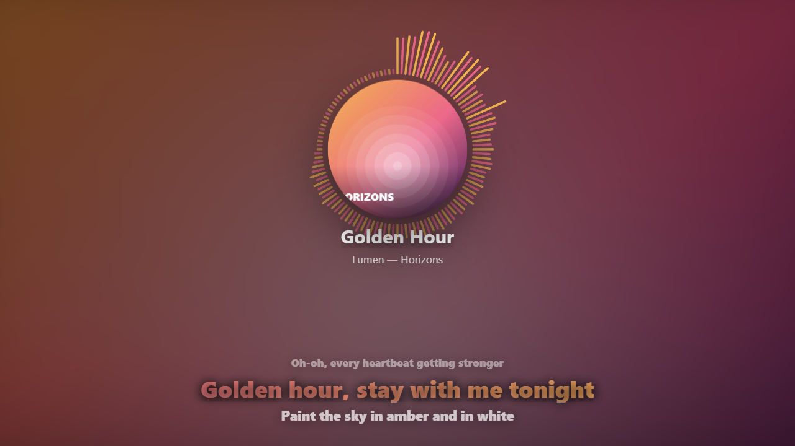</td>
<td>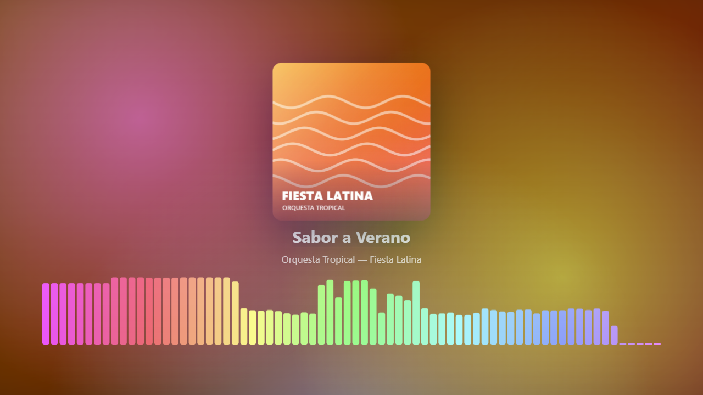</td>
</tr></table>

- Botón de los **dos monitores**: el video pasa al segundo monitor en pantalla completa. Doble clic: pantalla completa; `Esc`: salir.
- **Visualizadores** (*Ajustes → Pantalla de video*), para canciones de audio:
  - **Barras**: espectro clásico.
  - **Onda**: la forma de onda con brillo.
  - **Círculo**: barras alrededor de la carátula, que late con los graves.
  - **Fiesta**: luces de colores en toda la pantalla al ritmo de la música.
- **Transición suave (crossfade)**: en *Ajustes → Reproducción*, elige de 1 a 12 s para fundir canciones locales.

---

## Temporizador para dormir

Pulsa **🌙** en la barra inferior y elige **15, 30, 45, 60 o 90 minutos** o **Al terminar esta canción**. Al llegar el momento, el volumen baja poco a poco y la música se pausa. El número sobre la luna indica los minutos que faltan. Vuelve a pulsarla para cancelarlo.

---

## Mini reproductor e integración con Windows

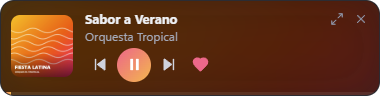

- **Mini reproductor**: botón 🗗 de la barra inferior. Es una ventanita flotante siempre encima con carátula, título, anterior / reproducir / siguiente, ❤ y progreso. Puedes arrastrarla; ⤢ vuelve a la app y ✕ la cierra.
- **Icono junto al reloj**: clic para mostrar la app; clic derecho para reproducir, pasar de canción, abrir el mini reproductor o salir.
- **Miniatura de la barra de tareas**: pasa el ratón por el icono de la app para ver los botones anterior / reproducir / siguiente.
- **Aviso de "Ahora suena"**: notificación de Windows al cambiar de canción si la ventana no está a la vista (*Ajustes → Reproducción*).
- **Teclas multimedia** del teclado: funcionan aunque la app esté en segundo plano.

---

## Control desde el celular

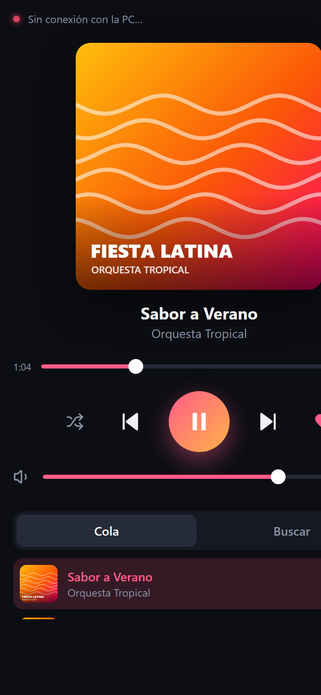

Actívalo en *Ajustes → Control desde el celular* y escanea el QR (mismo Wi-Fi). Desde el teléfono:

- Carátula, título y progreso en tiempo real.
- Reproducir / pausa, anterior, siguiente, aleatorio, ❤ y volumen.
- Pestaña **Cola**: toca una canción para saltar a ella.
- Pestaña **Buscar**: busca en *Mi música* o en *YouTube*; toca un resultado para reproducirlo ya o **+** para añadirlo a la cola.

Consulta el [tutorial de instalación](INSTALACION.md#-control-desde-el-celular) si el teléfono no conecta.

---

## Ajustes

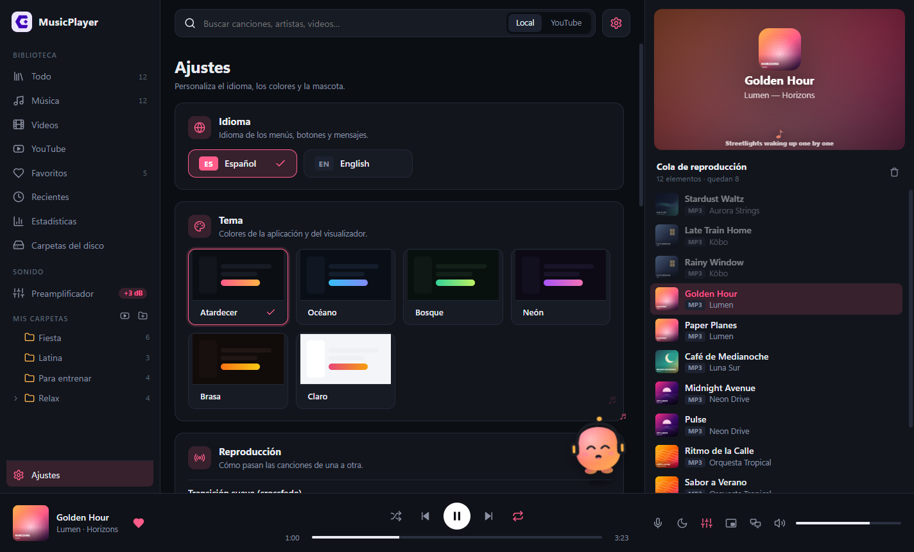

| Sección | Opciones |
|---|---|
| **Idioma** | Español o English (menús, botones, mensajes y menús de Windows). |
| **Tema** | Atardecer, Océano, Bosque, Neón, Brasa y Claro. |
| **Reproducción** | Transición suave (0–12 s), modo radio, aviso de "Ahora suena", igualar volumen. |
| **Pantalla de video** | Visualizador y letras tipo karaoke. |
| **Control desde el celular** | Activar / desactivar y código QR. |
| **Mascota** | Activar / desactivar, accesorio y devolverla a su sitio. |

---

## La mascota Tempo

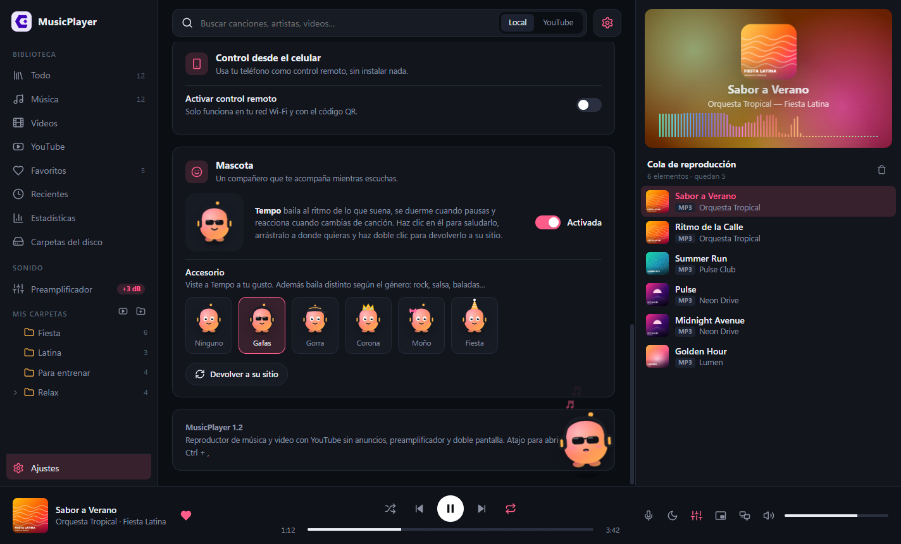

- **Baila** al ritmo de los graves de lo que suena (local y YouTube) y suelta notas musicales.
- **Según el género** cambia el baile: *headbang* con rock y metal, pasos laterales con salsa, cumbia y bachata, y balanceo lento con baladas, clásica, jazz y lo-fi. El género sale de las etiquetas del archivo o del título del video.
- **Se duerme** si no suena nada durante un rato.
- **Reacciona**: comenta al cambiar de canción, se alegra con tus favoritos y se pone triste si un video falla.
- **Haz clic** para saludarla, **arrástrala** a donde quieras y haz **doble clic** para devolverla a su sitio.
- **Accesorios**: gafas, gorra, corona, moño o gorro de fiesta.

---

## Atajos de teclado

| Tecla | Acción |
|---|---|
| `Espacio` | Reproducir / pausa |
| `Ctrl` + `→` / `Ctrl` + `←` | Siguiente / anterior |
| `→` / `←` | Adelantar / retroceder 5 s |
| `↑` / `↓` | Subir / bajar volumen |
| `M` | Silenciar |
| `S` | Aleatorio |
| `R` | Repetir |
| `F` | Favorito |
| `L` | Letra |
| `N` / `P` | Siguiente / anterior |
| `Ctrl` + `F` | Buscar |
| `Ctrl` + `,` | Ajustes |
| `Ctrl` + `A` | Seleccionar todo |
| `Supr` | Quitar de la carpeta abierta |
| `Enter` | Reproducir la selección |
| Teclas multimedia | Reproducir / pausa, siguiente, anterior y detener |
