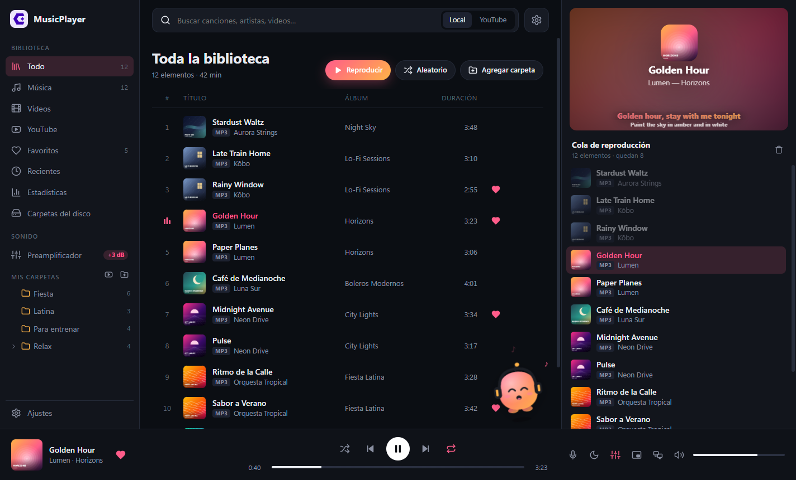
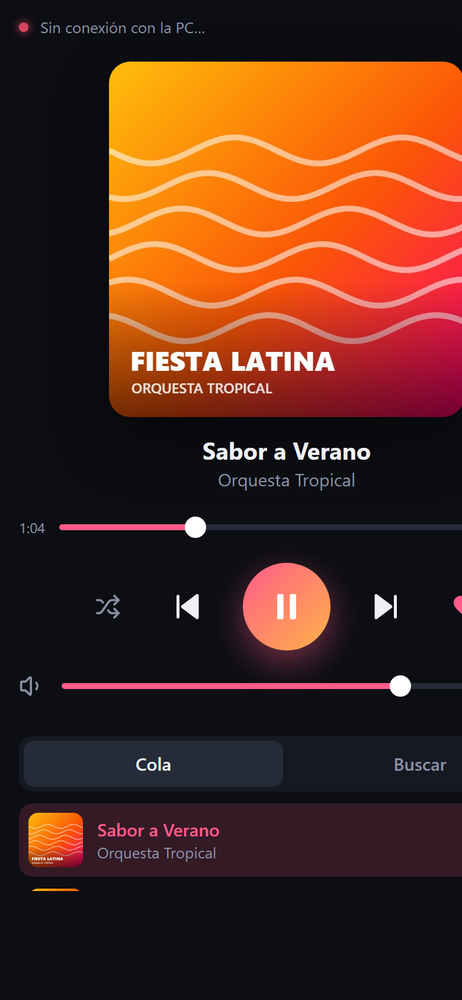

# 📥 Tutorial de instalación en PC

Esta guía explica, paso a paso, cómo instalar **Edros Music Player** en Windows, dejarlo listo con tu música y resolver los problemas más comunes.

**Índice**

1. [Requisitos](#-requisitos)
2. [Descargar el instalador](#-1-descargar-el-instalador)
3. [Aviso de Windows SmartScreen](#-2-aviso-de-windows-smartscreen)
4. [Asistente de instalación](#-3-asistente-de-instalación)
5. [Primer inicio: agregar tu música](#-4-primer-inicio-agregar-tu-música)
6. [Doble pantalla](#-doble-pantalla)
7. [Control desde el celular](#-control-desde-el-celular)
8. [Actualizar a una versión nueva](#-actualizar-a-una-versión-nueva)
9. [Desinstalar](#-desinstalar)
10. [Instalación silenciosa (avanzado)](#-instalación-silenciosa-avanzado)
11. [Solución de problemas](#-solución-de-problemas)

---

## ✅ Requisitos

| | Mínimo |
|---|---|
| Sistema | Windows 10 u 11 de **64 bits** |
| Espacio | ~400 MB libres |
| Internet | Solo para YouTube, letras y modo radio. Tu música local funciona sin conexión. |
| Permisos | No hace falta ser administrador: se instala para tu usuario. |

---

## ⬇️ 1. Descargar el instalador

1. Abre la página de **[Releases](https://github.com/Reingardo/Edros-Music-Player/releases/latest)** del proyecto.
2. En la sección **Assets** de la última versión, haz clic en **`MusicPlayer-Setup-x.y.z.exe`** (por ejemplo `MusicPlayer-Setup-1.2.0.exe`).
3. Espera a que termine la descarga (~120 MB). Normalmente queda en tu carpeta **Descargas**.

> 💡 Descarga el instalador **solo desde la página oficial de Releases** del repositorio.

---

## 🛡️ 2. Aviso de Windows SmartScreen

Al abrir el instalador, Windows puede mostrar una ventana azul que dice **"Windows protegió tu PC"**. Aparece porque el instalador no tiene firma digital comercial (los certificados de firma son de pago); no significa que tenga un virus.

Para continuar:

1. Haz clic en **Más información**.
2. Comprueba que el archivo sea `MusicPlayer-Setup-….exe`.
3. Pulsa **Ejecutar de todas formas**.

Si tu navegador marca la descarga como "poco común", elige **Conservar** (en Edge: menú **…** de la descarga → **Conservar** → **Conservar de todas formas**).

---

## 🧙 3. Asistente de instalación

1. **Opciones de instalación**: elige *Solo para mí* (recomendado).
2. **Carpeta de destino**: deja la que propone (`C:\Users\<tu usuario>\AppData\Local\Programs\MusicPlayer`) o pulsa **Examinar** para elegir otra.
3. Pulsa **Instalar** y espera unos segundos.
4. Deja marcada **Ejecutar MusicPlayer** y pulsa **Finalizar**.

Se crean accesos directos **MusicPlayer** en el **escritorio** y en el **menú Inicio**, con el logo de Edros.

---

## 🎵 4. Primer inicio: agregar tu música



1. En la barra lateral, abre **Carpetas del disco**.
2. Pulsa **Agregar carpeta** y elige la carpeta donde guardas tu música o tus videos (por ejemplo *Música* o *Descargas*). Puedes agregar varias.
3. La app analiza los archivos (también los de las subcarpetas) y los muestra en **Todo**, **Música** y **Videos**.
4. Haz **doble clic** en una canción para reproducirla.

Otras formas de agregar música:

- **Arrastra** archivos desde el Explorador de Windows a la ventana.
- Usa **Agregar archivos** para elegir archivos sueltos.
- Cambia el buscador a **YouTube** para buscar y reproducir videos.

> Al abrir la app se vuelven a revisar tus carpetas, así que las canciones nuevas aparecen solas.

---

## 🖥️ Doble pantalla

1. Conecta tu segundo monitor (o TV).
2. Pulsa el botón de los **dos monitores** en la barra inferior.
3. El video (o la carátula con el visualizador y la letra) se abre en **pantalla completa en el otro monitor**.
4. **Doble clic** sobre el video: entrar o salir de pantalla completa. **Esc**: salir de pantalla completa.
5. Para volver a una sola pantalla, pulsa el mismo botón o **Volver a una pantalla**.

Si no hay segundo monitor, el video se abre en su propia ventana, que puedes mover y agrandar.

---

## 📱 Control desde el celular



1. Conecta el celular **a la misma red Wi-Fi** que la PC.
2. En la app, abre el engrane ⚙ → **Control desde el celular** y activa **Activar control remoto**.
3. **La primera vez**, Windows mostrará un aviso del **Firewall de Windows Defender** para *MusicPlayer*. Marca **Redes privadas** y pulsa **Permitir**.
4. Aparece un **código QR**. Escanéalo con la cámara del celular y abre el enlace.
5. ¡Listo! Desde el teléfono puedes pausar, saltar, adelantar, cambiar el volumen, ver la cola y buscar en tu música o en YouTube.

> 🔐 El enlace del QR incluye una clave secreta. Sin ella nadie puede controlar la app, y el control remoto solo funciona en tu red local. Puedes desactivarlo cuando quieras.

<br clear="right">

---

## 🔄 Actualizar a una versión nueva

1. Descarga el instalador nuevo desde [Releases](https://github.com/Reingardo/Edros-Music-Player/releases/latest).
2. **Cierra MusicPlayer** (también desde el icono junto al reloj → *Salir*).
3. Ejecuta el instalador nuevo: reemplaza la versión anterior.

Tus carpetas, favoritos, estadísticas y ajustes **se conservan**: están en `%APPDATA%\MusicPlayer`.

---

## 🗑️ Desinstalar

- **Configuración de Windows → Aplicaciones → Aplicaciones instaladas → MusicPlayer → Desinstalar**, o
- **Panel de control → Programas y características → MusicPlayer → Desinstalar**.

Tus archivos de música **nunca se borran**. Si además quieres eliminar los datos de la app (carpetas, favoritos, ajustes), borra la carpeta `%APPDATA%\MusicPlayer` (pega esa ruta en la barra del Explorador).

---

## 🤖 Instalación silenciosa (avanzado)

Para instalar sin el asistente, por ejemplo en varias PC, abre PowerShell en la carpeta del instalador:

```powershell
.\MusicPlayer-Setup-1.2.0.exe /S
```

Para elegir la carpeta de destino:

```powershell
.\MusicPlayer-Setup-1.2.0.exe /S /D=C:\Apps\MusicPlayer
```

---

## 🧯 Solución de problemas

| Problema | Solución |
|---|---|
| **"Windows protegió tu PC"** | Más información → Ejecutar de todas formas ([ver arriba](#-2-aviso-de-windows-smartscreen)). |
| **El antivirus bloquea el instalador** | Es habitual con programas sin firma digital. Descárgalo solo desde Releases y añádelo a las excepciones de tu antivirus. |
| **No se oye nada** | Revisa el volumen de la app y el de Windows, y que no esté en silencio (`M`). En el ecualizador pulsa **Restablecer**. |
| **Un archivo no se reproduce** | Algunos códecs poco comunes (por ejemplo ciertos MKV o WMA) no son compatibles. Prueba a convertirlo a MP3 o MP4. |
| **Un video de YouTube no se reproduce** | Su propietario no permite verlo fuera de YouTube; la app salta al siguiente. Comprueba también tu conexión. |
| **No aparece la letra** | No todas las canciones están en lrclib.net. Pon un archivo `.lrc` con el mismo nombre junto a la canción. |
| **El celular no conecta** | Misma red Wi-Fi; firewall con **Redes privadas** permitido; desactiva y vuelve a activar el control remoto. Algunas redes de invitados o públicas aíslan los dispositivos. |
| **Ya permití el firewall pero sigue sin conectar** | Windows → *Firewall de Windows Defender* → *Permitir una aplicación* → busca **MusicPlayer** y marca **Privada**. |
| **La mascota estorba** | Arrástrala a otro sitio, haz doble clic para devolverla a su lugar o desactívala en Ajustes → Mascota. |
| **La doble pantalla abre una ventana pequeña** | Windows no detectó el segundo monitor. Revisa *Configuración → Pantalla* y pulsa *Detectar*. |

¿Otro problema? Abre un [issue](https://github.com/Reingardo/Edros-Music-Player/issues) explicando qué pasó y tu versión de Windows.
